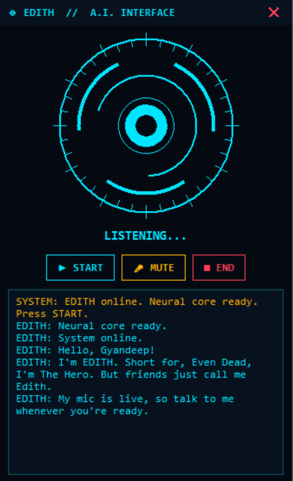

# 🤖 EDITH – Multilingual AI Personal Voice Assistant

### Your Personal AI Assistant | Inspired by JARVIS

**Developed by Madhu**

EDITH is a Python-based multilingual AI personal voice assistant designed to interact naturally through voice commands. It listens to your voice, understands your requests, generates intelligent responses and speaks back using AI-powered speech services.

EDITH features a futuristic desktop HUD interface, voice recognition, multilingual conversations, website launching, weather updates, personal memory and reminders.

The application is designed to run on a regular Windows computer without requiring an advanced GPU for its cloud-based AI processing.

---

## 🖥️ Project Preview



---

## ⚙️ How EDITH Works

EDITH combines speech recognition, AI processing and text-to-speech technology.

```text
       🎤 Microphone
             |
             v
       Audio Recording
             |
             v
      Groq Whisper STT
       (Speech Recognition)
             |
             v
       Python Assistant
        (Command Engine)
             |
       +-----+------+
       |            |
       v            v
   Local Commands  Groq AI
       |            |
       |            v
       |       AI Response
       |            |
       +-----+------+
             |
             v
       Edge TTS Engine
       (Voice Generation)
             |
             v
         🔊 Speaker
```

---

## ✨ Key Features

### 🎙️ Voice Interaction
- Voice-controlled personal assistant.
- Real-time microphone input.
- Automatic speech recognition.
- Natural voice responses.
- Background listening while the assistant is active.

### 🌍 Multilingual Support
- Telugu language support.
- English language support.
- Hindi language support.
- Support for mixed Telugu-English conversations.
- Language-based voice selection.

### 🧠 AI Intelligence
- AI-powered conversations using Groq.
- GPT-OSS model integration.
- General knowledge assistance.
- Programming and technical explanations.
- Context-aware conversation history.
- Personalized assistant personality.

### 🌐 Website Automation
Open websites using voice commands:

- YouTube
- Google
- Gmail
- GitHub
- Instagram
- Facebook
- LinkedIn
- WhatsApp Web
- ChatGPT

Example commands:

```text
EDITH, open YouTube.
EDITH, open Google.
EDITH, open Gmail.
EDITH, open GitHub.
```

### 🌦️ Weather Information
- Retrieve weather information.
- Temperature details.
- Feels-like temperature.
- Weather conditions.
- Humidity information.
- City-based weather queries.

### 🧠 Personal Memory
- Save information using voice commands.
- Store memories in SQLite.
- Retrieve previously saved information.
- Maintain personal assistant memory between sessions.

Example:

```text
Remember that I am a Python developer.

What do you remember?
```

### ⏰ Reminder System
- Create reminders using voice commands.
- Store reminders in SQLite.
- Background reminder monitoring.
- Automatic reminder notifications.

Example:

```text
Remind me in 5 minutes to study Python.
```

### 💻 Windows System Commands
EDITH supports selected Windows operations:

- Lock computer.
- Schedule computer shutdown.
- Cancel scheduled shutdown.
- Schedule computer restart.

### 🖥️ Futuristic HUD Interface
- Tkinter-based desktop interface.
- Animated assistant interface.
- START button.
- MUTE button.
- END button.
- Voice activity visualization.
- Assistant status display.
- User and assistant conversation display.

---

## 🛠️ Technologies Used

| Technology | Purpose |
|---|---|
| Python | Main programming language |
| Tkinter | Desktop graphical interface |
| Groq API | AI response generation |
| Groq Whisper | Speech recognition |
| GPT-OSS | AI language model |
| Edge TTS | Text-to-speech |
| PyAudio | Microphone audio recording |
| Pygame | Audio playback |
| SQLite | Memory and reminder storage |
| Requests | API communication |
| Python-dotenv | Environment configuration |
| Regular Expressions | Voice command processing |

---

## 📁 Project Structure

```text
EDITH-AI/
│
├── assistant_interface.py
├── assistant_core.py
│
├── .env
├── .env.example
├── .gitignore
│
├── requirements.txt
│
├── edith_memory.sqlite3
│
├── screenshot.png
│
├── README.md
│
└── venv/
```

*The project structure may vary depending on your local setup. Do not upload your virtual environment or private API credentials.*

---

## 🚀 Installation and Setup

### Step 1: Install Python

Install Python 3.10 or newer.

Verify installation:

```bash
python --version
```

### Step 2: Clone the Repository

```bash
git clone YOUR_GITHUB_REPOSITORY_URL
```

Navigate into the project:

```bash
cd EDITH-AI
```

### Step 3: Create a Virtual Environment

```bash
python -m venv venv
```

### Step 4: Activate Virtual Environment

Windows:

```bash
venv\Scripts\activate
```

### Step 5: Install Dependencies

```bash
python -m pip install --upgrade pip
```

```bash
pip install -r requirements.txt
```

### Step 6: Configure Environment Variables

Create a `.env` file in the project directory.

Example:

```env
ASSISTANT_NAME=EDITH
USER_NAME=Madhu

GROQ_API_KEY=YOUR_GROQ_API_KEY

GROQ_MODEL=openai/gpt-oss-20b
STT_MODEL=whisper-large-v3-turbo

DEFAULT_LANGUAGE=te
AUTO_LANGUAGE_DETECTION=true

VOICE_EN=en-IN-NeerjaNeural
VOICE_HI=hi-IN-SwaraNeural
VOICE_TE=te-IN-ShrutiNeural

TTS_RATE=+0%
TTS_PITCH=+0Hz

MIC_THRESHOLD=500
```

Replace `YOUR_GROQ_API_KEY` with your personal API key.

**Never publish your `.env` file or API key on GitHub.**

---

## 🔑 API Configuration

### Groq API

EDITH uses Groq for:

1. Speech recognition through Whisper.
2. AI response generation through GPT-OSS.

To configure Groq:

1. Visit https://console.groq.com/
2. Create an account.
3. Open the API Keys section.
4. Generate an API key.
5. Add it to your `.env` file.

Check the provider's current pricing, usage limits and model availability before use.

---

## ▶️ Run EDITH

After completing the installation and configuration:

```bash
python assistant_interface.py
```

Click the **START** button and begin speaking.

Use the **MUTE** button to mute the microphone and the **END** button to stop the assistant.

---

## 💬 Example Voice Commands

| Voice Command | Expected Action |
|---|---|
| Open YouTube | Opens YouTube |
| Open Google | Opens Google |
| Open Gmail | Opens Gmail |
| Open GitHub | Opens GitHub |
| Weather in Hyderabad | Retrieves weather information |
| What is Python? | AI-generated explanation |
| Remember that I am a developer | Saves a memory |
| What do you remember? | Retrieves saved memories |
| Remind me in 5 minutes to study | Creates a reminder |
| Lock computer | Locks Windows |
| Cancel shutdown | Cancels scheduled shutdown |

---

## 🔒 Security and Privacy

- API credentials are stored in environment variables.
- SQLite stores local memories and reminders.
- Do not upload `.env` files.
- Do not share API keys publicly.
- Voice recognition and AI responses require external API services.
- Review third-party service privacy policies before use.

---

## ⚠️ Current Limitations

- Internet access is required for cloud-based AI services.
- API usage is subject to provider limits and availability.
- Voice recognition accuracy depends on microphone quality and background noise.
- EDITH cannot interrupt speech playback mid-sentence.
- Website launching depends on the system's default browser.
- Some system commands are specific to Windows.

---

## 🔮 Future Enhancements

Potential future improvements include:

- Wake-word detection.
- Interruptible voice conversations.
- More advanced multilingual recognition.
- Improved conversation memory.
- Email automation.
- Calendar integration.
- File and folder management.
- Smart home integration.
- Computer vision.
- More advanced desktop automation.
- Customizable HUD themes.

---

## 👨‍💻 Developer

**Madhu**

Computer Science Engineering Graduate | Python Developer | AI Enthusiast

EDITH is a personal AI assistant project developed to explore Python automation, voice recognition, AI integration and desktop application development.

---

## 🙏 Acknowledgements

Special thanks to the developers and communities behind:

- Python
- Groq
- Whisper
- Microsoft Edge TTS
- Pygame
- Tkinter

---

## 📜 License

Choose and include an appropriate open-source license before distributing this project. Keep any third-party license and attribution requirements intact.

---

### ⭐ Support

If you find this project interesting, consider giving the repository a star on GitHub.

**EDITH – Your Personal AI Assistant.**

*Listen. Think. Respond.*